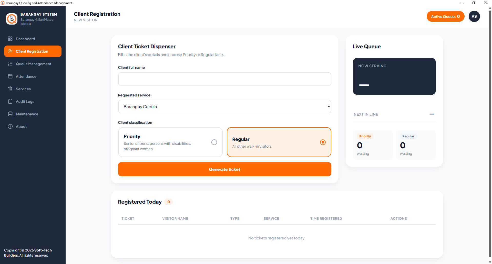
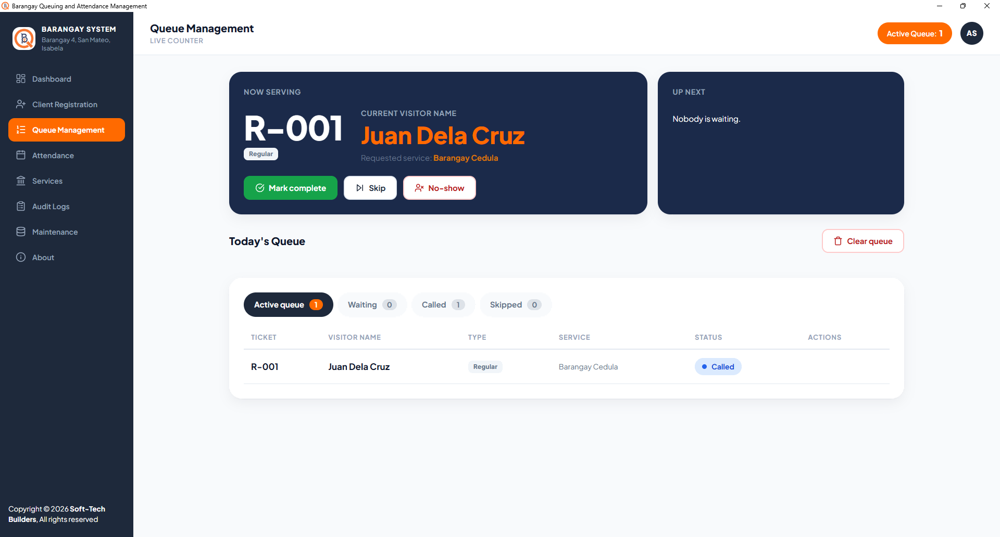
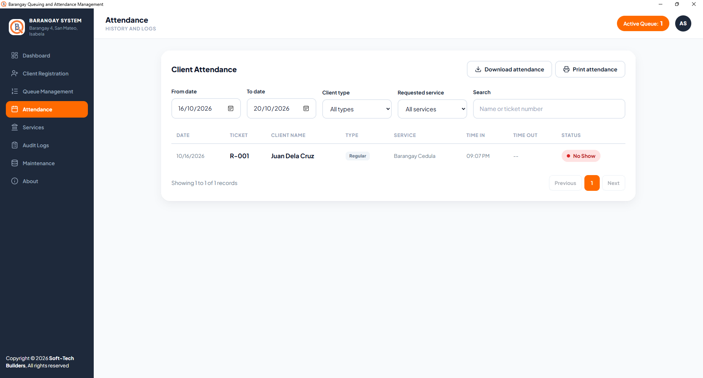
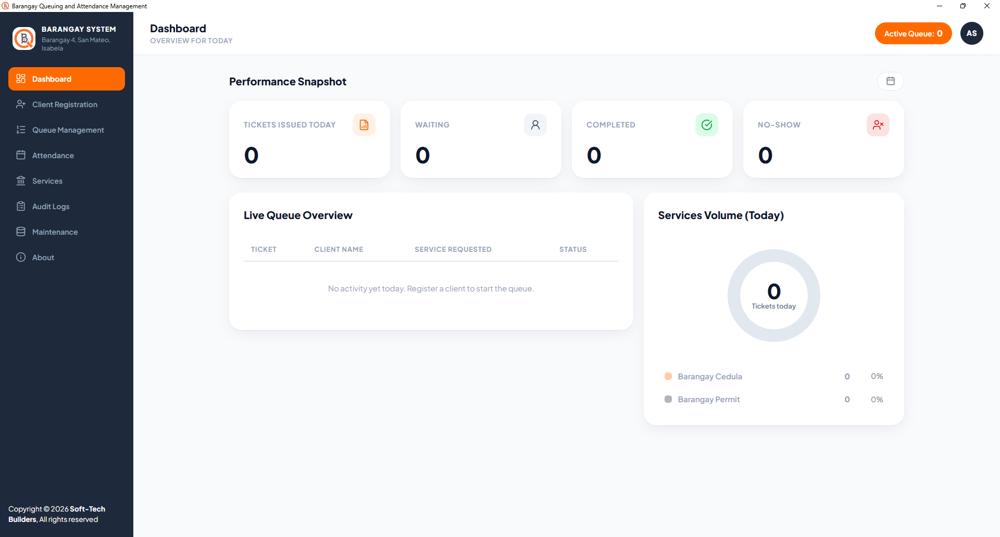

# Barangay Queuing and Attendance Management System

**An offline queue, service and attendance system for the Barangay 4 office in San Mateo, Isabela. One Windows desktop app, with no internet and no server to maintain.**


A secretary registers each walk-in visitor, prints a numbered slip, and calls visitors in order, with senior citizens, persons with disabilities and pregnant women served first. Every visit is saved as a permanent attendance record that can be filtered, printed and exported.

| | |
|:--:|:--:|
| <br>**Register a visitor and issue a ticket** | <br>**Call, complete, skip or mark no-show** |
| <br>**Searchable attendance history** | <br>**Today at a glance** 
| <br>**add, edit, delete a service** |

**Current version:** 1.0.1

## Why it matters

Walk-in service at a small office often runs on shouted names and a paper logbook. Priority visitors wait behind everyone else, nobody can say how many people were served, and reports are written from memory.

This system replaces that with:

- **Fair, visible order.** Every visitor gets a numbered ticket, and the queue is called in a set pattern.
- **Priority that actually works.** Priority and Regular lanes are served in a 2:1 pattern, so Regular visitors still move.
- **Records without paper.** Every completed or missed visit is stored with the time in and out, ready for reports.
- **No dependence on connectivity.** It runs entirely on one PC, so a poor connection can't stop the office.
- **Resident data stays in the office.** Nothing is sent over the internet.

## Features

**Queueing**
- Priority and Regular lanes, with tickets numbered per lane (`P-001`, `R-014`) and reset each day
- Call Next with spoken announcement of the ticket number, using bundled audio, so no internet or speech engine is needed
- Complete, Skip (and Recall later), and No-Show, with a clear end-of-day **Clear queue**
- Live panels that update instantly, and protection against double clicks and duplicate tickets

**Records**
- Attendance history with date range, client type, service and name/ticket search
- Print view and CSV export
- Dashboard with today's totals and service volume

**Administration**
- Single administrator account with first-time setup, password change, and recovery key reset
- Service directory (add, edit, remove) and an **audit log** of every action
- Automatic daily backups, manual backup (including to a USB drive), and purge of old records
- An **About** page showing the version, developers, technologies and support contact

**Hardware**
- Prints queue slips on ESC/POS thermal receipt printers (58 mm or 80 mm) installed in Windows, with a test slip and reprint

## How it works

1. **Register.** The secretary enters the visitor's name, service and lane. A ticket is issued and a slip is printed.
2. **Call.** Pressing *Call next* announces the ticket number aloud and shows the visitor at the counter.
3. **Serve.** The secretary marks the visit *complete*, or *skip* if the visitor stepped away, or *no-show* if they never came. Skipped visitors can be recalled.
4. **Close the day.** *Clear queue* records anyone still unserved as no-show. A backup is taken automatically each day.
5. **Report.** The Attendance page filters the history and prints or exports it.

## Getting started

### Install

1. Run `Barangay_Queuing_Attendance_Management_Setup.exe` and accept the terms. The installer is not code-signed, so Windows may show "Windows protected your PC": choose **More info**, then **Run anyway**.
2. Open the app and create the administrator account.
3. **Write down the recovery key** shown at the end of setup. It appears only once and is the way back in if the password is lost.

**Requirements:** 64-bit Windows 10 or 11. The Microsoft Edge WebView2 Runtime, which is already on most up-to-date systems. A thermal printer is optional.

### Set up the receipt printer

1. Install the printer in Windows as usual.
2. Open **Maintenance → Receipt printer**, choose the printer and the paper width, and press **Save printer**.
3. Press **Print test slip** to check that the text fits on one line.

### Run from source

To build the installer, run `build.bat` (PyInstaller), then open `installer.iss` in [Inno Setup](https://jrsoftware.org/isinfo.php) and press **Ctrl+F9**. The result is `installer_output\Barangay_Queuing_Attendance_Management_Setup.exe`.

The app is built for Windows. For development without a printer, set the environment variable `BQS_DUMMY_PRINTER=1`: each slip is then written to `last_ticket_printed.txt` instead of being printed.

## Built with

| Area | Technology |
|---|---|
| Languages | Python 3.13, JavaScript, HTML5, CSS3 |
| Backend | FastAPI, Uvicorn |
| Database | SQLite through SQLAlchemy, with self-applying schema upgrades |
| Frontend | Jinja2 templates, plain CSS, vanilla JavaScript, Plus Jakarta Sans |
| Live updates and audio | FastAPI WebSockets, pre-recorded MP3 announcements |
| Security | Session cookies (Starlette), bcrypt password hashing |
| Printing | python-escpos and pywin32 (ESC/POS thermal printers) |
| Desktop and packaging | pywebview, PyInstaller, Inno Setup |

## Your data

All data lives on the office computer in `%LOCALAPPDATA%\Barangay_Queuing_Attendance_Management`: the database, backups and logs. Uninstalling the program does not delete it. Passwords and the recovery key are stored only as hashes.

## Scope

Built for **one office, one queue and one administrator** on one Windows PC. The barangay name and branding are set for Barangay 4, San Mateo, Isabela. It has no multi-counter mode, no user roles beyond the administrator, and no online services.

A configurable edition for other offices is planned as a separate project.

## Project layout

```
main.py           routes, queue logic, printing, audit log, backups
database.py       models and database upgrades
run_app.py        desktop launcher
templates/        pages           static/    CSS, JavaScript, fonts, audio clips
build.bat         app build       installer.iss   Windows installer script
```

## Team

Developed by **Soft-Tech Builders**, University of La Salette, Inc.

| Developer | Role |
|---|---|
| Joseph R. Dionisio | Full Stack Developer |
| Jhade Lorenz G. Martin | Documentation, Hardware Integration and Testing Support |
| Katrina Jessica Manzanillo | QA Lead, Client Coordination and Consultation |

## Acknowledgements

With sincere thanks to the people and communities who made this system possible:

- **Hon. Leo Aguilar Umipig**, Barangay Captain
- **Mary Joy D. Del Mundo**, Barangay Secretary
- **Prof. King Christian D. Antonio**, Project adviser
- **University of La Salette, Inc.**, School

## Contact

Questions, bug reports or support requests: **softtech.builders26@gmail.com**
